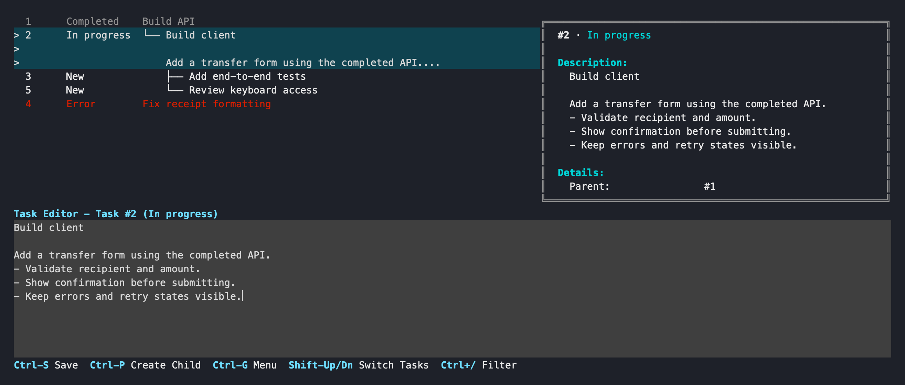

# qqq

**Give your coding agents a shared queue.**

You write the tasks. Agents claim the next ready one, report progress, and mark it
done. qqq keeps the queue in your project, with a terminal dashboard for the work
you want to inspect or change yourself.



[Get started](#try-it) · [Agent setup](#give-your-agent-the-queue) · [Docs](docs/reference.md)

## Why a queue?

- **Multiple agents, clear ownership.** Workers sharing the same local
  project claim separate tasks.
- **Dependencies that mean something.** “Build the client” waits until “Build the
  API” is complete. Priorities choose which ready task comes next.
- **Context that survives a session.** Descriptions, updates, screenshots, and
  history stay with the task when you return, retry, or hand off work.

SQLite stores tasks in `.qqq/qqq.db`; images live in `.qqq/images/`. No server or
account needed. Your agent runs the code and checks; qqq tracks the work.

## Install

```sh
cargo install qqq-cli --locked
```

Requires Rust 1.89+ and a C compiler. The command is `qqq`.
[Install from source](docs/reference.md#install-from-source) for development features.

## Try it

Start in an empty directory so the example task IDs match:

```sh
mkdir qqq-demo
cd qqq-demo
qqq init

qqq add "Build API"
qqq add "Build client" --parent 1
qqq list
```

```text
ID     STATUS        PRI TASK
1      New             0 Build API
2      New             0 └── Build client
```

Open your coding agent in this directory and send this prompt:

```text
Use `qqq next --wait --json` to wait for the next task and work on it. Mark it complete, then repeat. Keep one waiter running; don't repeatedly poll for work.
```

The agent completes **Build API** before **Build client** becomes ready.
Repeated `next` calls return your active task until you complete or release it.
If no task is available, `next` exits with status 1 and prints the pickup message
(or `null` with JSON output). This also applies to `--dry-run`; `--wait` keeps
waiting instead. `--explain` remains a successful diagnostic, even for an empty queue.

For your own project, run `qqq init` at its root and use the IDs returned by `add`.
Commands also work from subdirectories. Add `.qqq/` to your `.gitignore`.

Recognized agent callers get JSON by default: native Codex sessions
(`CODEX_THREAD_ID` or `CODEX_SESSION_ID`) and exact Herdr panes reporting an
agent. Use global `--human` for readable text, or `--json` to request JSON
explicitly. Ordinary shells keep readable output, including when piped.
Help and version output stay text.

## See and edit the work

```sh
qqq tui
```

Browse tasks, read their details, and edit descriptions in one window. Click a
task to open it, or use the keyboard:

| Key | Action |
| --- | --- |
| Shift+Up / Shift+Down | Move between tasks and a blank draft |
| Ctrl+S | Save |
| Ctrl+L | Edit tags |
| Ctrl+F | Filter tasks |
| Ctrl+G | Open task or bulk actions |

See the [full TUI guide](docs/reference.md#task-tui) for navigation, child tasks,
saved views, bulk selection, and shortcuts.

With optional [Herdr integration](docs/reference.md#herdr), Ctrl+H creates a worker
for a saved New task or opens its linked agent. Creation requires the pane's shell
profile to start Codex.

For CLI workflows, see [adding and editing](docs/reference.md#add-and-edit),
[batch imports](docs/reference.md#atomic-batch-import), and
[bulk actions](docs/reference.md#bulk-task-actions).

## Give your agent the queue

Use the [prompt above](#try-it) in each agentic coding tool you want to work
through the queue. Each worker needs a unique, stable identity.

`--wait` blocks until work is ready. `--json` returns full task data for the agent.
A worker using the same identity gets its active task back. Claims have no time
limit, but qqq marks tasks `error` when their owner is confirmed dead.
[Return or retry work](docs/reference.md#return-or-retry-work) when a worker gets
stuck or its task needs recovery.

Native Codex session discovery can supply identity automatically. Optional
[Herdr integration](docs/reference.md#herdr) links live agents and lets Ctrl+H
create a queue worker from a saved New task. `next` always claims for its caller.
Without automatic identity, set a unique `QQQ_SESSION` (for example,
`export QQQ_SESSION=worker-1`) or pass `--session worker-1` on worker commands.

Route specialist workers by stored tags:

```sh
qqq next --wait --tag frontend --tag bug
qqq list --tag "UI review" --filter 'has_tag("frontend") and priority >= 5'
```

Repeated tags require every exact label; case and Unicode stay distinct.
Existing owned tasks return even after selectors change.
See [tag matching and filter examples](docs/filter.md).

Save shared CLI/TUI selectors as project views:

```sh
qqq view save "Ready frontend" --tag frontend --readiness ready --max-completed 0
qqq list --view "Ready frontend"
qqq next --view "Ready frontend" --wait --json
qqq tui --view "Ready frontend"
```

Additional selectors combine with saved criteria using AND. Ctrl-B switches views
without losing unsaved drafts. Commit `.qqq-views.json` to share definitions.
See [named views, visibility overrides and picker](docs/views.md).

## Keep going

- [Commands, filters, and JSON](docs/reference.md#list-and-show)
- [Ownership, failures, and recovery](docs/reference.md#agents-and-recovery)
- [Images and dependencies](docs/reference.md#dependencies-and-images)
- [Backups and project health](docs/reference.md#data)
- [Config and aliases](docs/reference.md#config-and-aliases)
- [Build, test, and contribute](docs/reference.md#development)

[MIT license](LICENSE).
