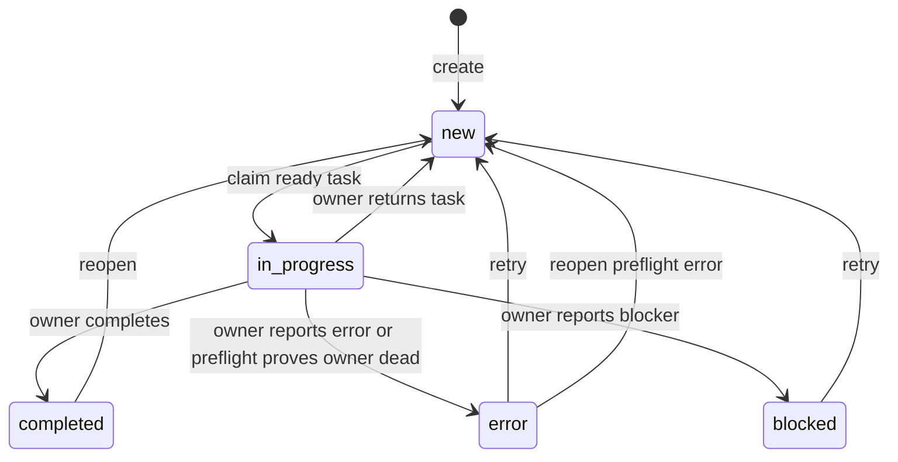

# Task state transitions

This describes the persisted `tasks.status` lifecycle in the current source
checkout. The CLI and TUI expose the transitions below; lifecycle changes and
their corresponding event records are committed together.

## Persisted states

| Status | Meaning |
| --- | --- |
| `new` | Waiting in the queue. Claimable when unarchived and all parent and prerequisite tasks are completed. |
| `in_progress` | Claimed by one session. This is the only status with a `claim_key`. |
| `completed` | Work is finished. It can be reopened. |
| `error` | Work failed or its owner was proven dead. A reason is stored as a message. |
| `blocked` | The owner reported that work cannot proceed. A reason is stored as a message. |

Queue diagnostics also use “blocked” for a `new` task that is not ready because
of unfinished dependencies. That diagnostic does not change the task's
persisted status.

## Normal lifecycle

| Transition | How it happens | Guard |
| --- | --- | --- |
| Create → `new` | `qqq add`, import, or recipe application | New tasks start unarchived and unassigned. |
| `new` → `in_progress` | `next` or a worker claims a task | The task must be unarchived and ready: its parent and every prerequisite are completed. |
| `in_progress` → `completed` | `qqq edit ID --complete` or TUI Complete | The current owner must match. The TUI also offers an explicit force-complete confirmation. |
| `in_progress` → `new` | `qqq edit ID --set-pending` or `--set-status new` | The current owner must match; this releases the claim. |
| `in_progress` → `error` | `qqq edit ID --set-status error --reason TEXT` | The current owner must match and the reason must be nonblank. Owner preflight can also set `error` when it proves the claim owner is dead. |
| `in_progress` → `blocked` | `qqq edit ID --set-status blocked --reason TEXT` | The current owner must match and the reason must be nonblank. |
| `error` or `blocked` → `new` | `qqq edit ID --set-status new` or TUI Retry | No owner is required. The reason and prior history remain. |
| `completed` → `new` | `qqq edit ID --reopen` or TUI Reopen | The task must be unarchived. Reopening also checks unfinished archived dependencies. |
| `in_progress` → `new` via Reopen | `qqq edit ID --reopen` | Allowed only when the saved Herdr owner can be verified absent. The TUI offers a separate force-reopen confirmation. |
| Preflight `error` → `new` | `qqq edit ID --reopen` | Normal reopen accepts an error only when its latest relevant error event came from owner preflight. Use Retry for manually reported errors. |

## Explicit force actions

The TUI's uppercase `Y` confirmation deliberately bypasses the normal owner or
reopen checks. It can:

- force-complete a `new`, `in_progress`, `error`, or `blocked` task;
- force-mark a `new` or `in_progress` task as `error`;
- force-reopen a `completed` or `in_progress` task to `new`.

The CLI also accepts `qqq edit ID --set-status new --force` to return an
`in_progress`, `error`, or `blocked` task to `new` without matching its owner.
This flag does not force-complete or reopen a completed task.

## Invariants and related fields

- `claim_key` is set only while status is `in_progress`; leaving that status
  clears it. The active claim is unique to one task.
- Claims, releases, completions, errors, blocked reports, and reopens append an
  event. Error and blocked reasons are also saved as task messages.
- Assignment metadata and the saved Herdr link remain after a task leaves
  `in_progress`; a new claim may replace the link.
- `archived` is independent of status. It does not create another lifecycle
  state, but archived tasks cannot be claimed and active tasks cannot be
  archived.
- Status transitions can be combined with supported direct edits; the status,
  event, and accompanying edits commit atomically.

For command syntax and TUI behavior, see the [command reference](reference.md),
especially [completion](reference.md#complete-work),
[reopening](reference.md#reopen-work),
[returning or retrying work](reference.md#return-or-retry-work), and
[action confirmations](reference.md#action-confirmations).
